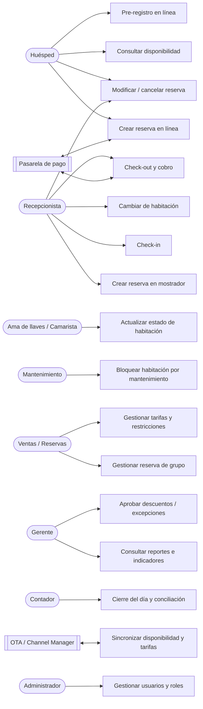
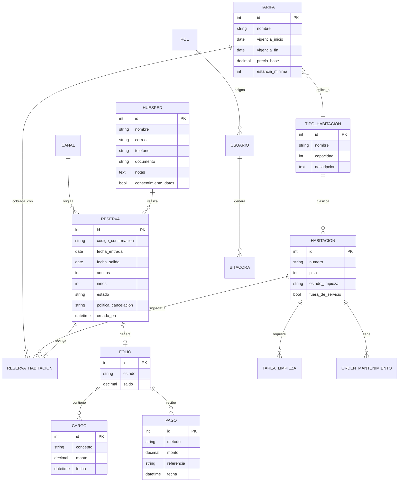

# Plataforma de Gestión de Reservas de Habitaciones
## Documento de levantamiento de necesidades, casos de uso, historias de usuario y árboles de problemas

> **Nota de rol:** Este documento está escrito desde la perspectiva del **cliente** (la dirección del hotel). Es un cliente ficticio, pero realista, construido tomando como inspiración sistemas existentes de gestión hotelera. Las secciones en primera persona son "la voz del cliente".

---

## Índice

1. [Quién soy y cuál es mi situación](#1-quién-soy-y-cuál-es-mi-situación)
2. [Sistemas que he usado o evaluado (inspiración)](#2-sistemas-que-he-usado-o-evaluado-inspiración)
3. [Lo que realmente necesito (y lo que no)](#3-lo-que-realmente-necesito-y-lo-que-no)
4. [Actores del sistema](#4-actores-del-sistema)
5. [Reglas de negocio](#5-reglas-de-negocio)
6. [Casos de uso](#6-casos-de-uso)
7. [Historias de usuario](#7-historias-de-usuario)
8. [Árboles de problemas y soluciones](#8-árboles-de-problemas-y-soluciones)
9. [Requerimientos no funcionales](#9-requerimientos-no-funcionales)
10. [Modelo de datos preliminar](#10-modelo-de-datos-preliminar)
11. [Priorización y hoja de ruta](#11-priorización-y-hoja-de-ruta)
12. [Riesgos y preguntas abiertas](#12-riesgos-y-preguntas-abiertas)
13. [Glosario](#13-glosario)

---

## 1. Quién soy y cuál es mi situación

Soy el director de un **hotel de tamaño medio (60 habitaciones)**, con ocupación media anual cercana al 65 % y picos de más del 95 % en temporada alta y fines de semana largos. Tenemos:

- **Recepción** operando 24 horas, en tres turnos.
- **Ama de llaves** (housekeeping) con 8 a 12 camaristas por turno.
- **Un pequeño equipo comercial / de reservas** (2 personas).
- **Administración y contabilidad** (1 contador externo).
- **Mantenimiento** (2 técnicos).
- Venta por **cuatro vías**: teléfono/WhatsApp, correo, walk-in y agencias en línea (OTAs).

### Cómo trabajamos hoy (el dolor real)

| Herramienta actual | Para qué se usa | Problema |
|---|---|---|
| Hoja de cálculo compartida | Calendario de ocupación | Dos personas editan a la vez y se pisan; hemos tenido **sobreventa** |
| Cuaderno de recepción | Notas de huéspedes y peticiones especiales | Se pierde información entre turnos |
| Extranets de OTAs (varias) | Actualizar disponibilidad y tarifas | Hay que entrar a cada una manualmente; se desincronizan |
| WhatsApp personal del encargado | Coordinar con housekeeping | No hay trazabilidad, nadie sabe qué cuarto está listo |
| Terminal de pago + Excel | Cobros y conciliación | Cierre de caja tarda 2 horas y rara vez cuadra al primer intento |

**Mi objetivo de negocio:** reducir errores de reserva a casi cero, aumentar la venta directa (menos comisión de OTAs), y que cualquier persona del equipo pueda saber en 5 segundos *qué habitaciones están disponibles, cuáles están sucias y quién llega hoy*.

---

## 2. Sistemas que he usado o evaluado (inspiración)

Estos son los sistemas que revisé antes de escribir esto. No quiero copiarlos; quiero **tomar lo que funciona** y evitar lo que me estorba.

| Sistema | Tipo | Lo que me gusta | Lo que no me gusta |
|---|---|---|---|
| **Oracle OPERA Cloud** | PMS para cadenas grandes | Modelo muy completo de reservas, folios, tarifas y reportes de auditoría nocturna | Enorme, caro, curva de aprendizaje larga; sobra el 70 % de las funciones para mi tamaño |
| **Cloudbeds** | PMS + channel manager + motor de reservas | Todo integrado, calendario visual claro, buena sincronización con OTAs | Reportes poco flexibles; personalizar tarifas complejas es torpe |
| **Mews** | PMS en la nube moderno | Experiencia de uso excelente, check-in en línea, API abierta | Precio por módulos que se acumula |
| **Little Hotelier / RoomRaccoon** | PMS para hoteles pequeños | Simple, rápido de aprender, barato | Se queda corto con grupos, tarifas por canal y reportes financieros |
| **SiteMinder / channel managers** | Distribución | Sincronización de disponibilidad y precios con muchas OTAs | Solo resuelve distribución, no operación interna |
| **Booking.com / Expedia (extranets)** | Canales de venta | Panel de reservas y mensajería con el huésped | Cada uno funciona distinto; no son una fuente única de verdad |
| **Airbnb (modelo de reservas)** | Marketplace | Flujo de reserva muy claro, mensajería integrada, políticas de cancelación visibles | Pensado para anfitriones individuales, no para inventario de hotel |

### Ideas concretas que quiero heredar

1. **Calendario tipo "tarjeta/tape chart"** (Cloudbeds, OPERA): filas = habitaciones, columnas = días, reservas como barras arrastrables.
2. **Estado de habitación en tiempo real** (OPERA, Mews): limpia / sucia / inspeccionada / fuera de servicio.
3. **Folio único por estancia** (OPERA): todos los cargos y pagos de la estancia en un solo lugar.
4. **Check-in en línea / pre-registro** (Mews): que el huésped llene sus datos antes de llegar.
5. **Sincronización bidireccional con canales** (SiteMinder, Cloudbeds): una sola fuente de verdad de disponibilidad.
6. **Mensajería con plantillas** (Booking, Airbnb): confirmaciones, recordatorios y encuestas automáticas.
7. **Auditoría nocturna / cierre del día** (OPERA): proceso que cierra la jornada y bloquea cambios.

---

## 3. Lo que realmente necesito (y lo que no)

Después de analizar mis problemas, separo lo que **necesito de verdad** de lo que solo suena bien en una demo.

### 3.1 Necesidades reales (el "por qué" detrás del "qué")

| # | Necesidad real | Lo que pido en forma de funcionalidad |
|---|---|---|
| N1 | **Nunca vender dos veces la misma habitación** | Inventario único y centralizado con control de concurrencia |
| N2 | **Saber qué hay disponible y a qué precio, al instante** | Consulta de disponibilidad rápida con tarifas aplicadas |
| N3 | **Que los canales externos siempre vean lo mismo que yo** | Sincronización automática con OTAs |
| N4 | **Que recepción y limpieza hablen el mismo idioma** | Estados de habitación compartidos en tiempo real |
| N5 | **Cobrar sin errores y cerrar el día sin dolor** | Folio, pagos, cierre de caja y reportes |
| N6 | **Conocer a mi huésped** | Perfil con historial, preferencias y notas |
| N7 | **Vender más directo** | Motor de reservas en mi sitio web con pago en línea |
| N8 | **Tomar decisiones con datos** | Reportes de ocupación, ADR, RevPAR, origen de reservas |
| N9 | **Reducir cancelaciones tardías y no-shows** | Políticas claras, garantías, recordatorios |
| N10 | **Que el sistema no dependa de una sola persona** | Roles, permisos, bitácora de cambios |

### 3.2 Clasificación MoSCoW

| Prioridad | Funcionalidad |
|---|---|
| **Debe tener (Must)** | Inventario y disponibilidad, reservas (crear/modificar/cancelar), tarifas básicas, check-in / check-out, estado de habitaciones, folio y pagos, gestión de huéspedes, roles y permisos, reportes básicos, bitácora de auditoría |
| **Debería tener (Should)** | Motor de reservas web, integración con 1–2 OTAs, mensajería automática, pre-registro en línea, reservas de grupo, cierre del día |
| **Podría tener (Could)** | Gestión de mantenimiento, programa de lealtad, upselling (mejora de habitación), revenue management sugerido, app móvil para camaristas |
| **No por ahora (Won't)** | Restaurante / POS completo, spa, gestión de eventos, contabilidad completa, cerraduras inteligentes |

> **Mi advertencia como cliente:** prefiero un sistema que haga **12 cosas muy bien** a uno que haga 60 mal. Si algo no resuelve una de las necesidades N1–N10, no es prioridad.

---

## 4. Actores del sistema

| Actor | Descripción | Objetivos principales |
|---|---|---|
| **Huésped** | Persona que reserva y se hospeda | Reservar fácil, saber el costo total, modificar o cancelar, recibir confirmación |
| **Recepcionista** | Atiende llegadas, salidas y consultas | Crear/modificar reservas, hacer check-in/out, cobrar |
| **Ama de llaves** | Coordina limpieza | Ver qué habitaciones limpiar, priorizar llegadas, reportar incidencias |
| **Camarista** | Limpia habitaciones | Marcar habitaciones como limpias, reportar faltantes |
| **Personal de reservas / ventas** | Gestiona canal directo, grupos y empresas | Cotizar, bloquear inventario, gestionar tarifas |
| **Gerente / Director** | Supervisa la operación | Ver indicadores, aprobar descuentos, auditar cambios |
| **Contador / Administración** | Control financiero | Conciliar pagos, facturar, exportar movimientos |
| **Mantenimiento** | Resuelve fallas | Recibir y cerrar órdenes de trabajo, bloquear habitaciones |
| **Administrador del sistema** | Configura la plataforma | Usuarios, roles, tarifas, tipos de habitación, integraciones |
| **Sistema externo: OTA / Channel Manager** | Canales de venta | Recibir disponibilidad y tarifas; enviar reservas |
| **Sistema externo: Pasarela de pago** | Procesa pagos | Autorizar, cobrar, reembolsar |
| **Sistema externo: Facturación / correo / SMS** | Servicios de apoyo | Emitir facturas, enviar notificaciones |

---

## 5. Reglas de negocio

| ID | Regla |
|---|---|
| RN-01 | Una habitación **no puede tener dos reservas confirmadas con fechas que se solapen** (la noche de salida no se solapa con la de entrada del siguiente). |
| RN-02 | Hora estándar de **check-in: 15:00** y **check-out: 12:00**. El early check-in / late check-out puede tener cargo y requiere autorización. |
| RN-03 | Toda reserva debe tener al menos: titular, fechas, tipo de habitación, número de adultos/niños, tarifa y medio de contacto. |
| RN-04 | Las tarifas pueden variar por **temporada, día de la semana, canal y plan** (solo habitación / con desayuno). |
| RN-05 | Políticas de cancelación configurables: **flexible** (gratis hasta 48 h antes), **moderada** (cargo de 1 noche) y **no reembolsable**. |
| RN-06 | Una reserva sin garantía (tarjeta o depósito) se **libera automáticamente** a las 18:00 del día de llegada si está configurada como "sin garantía". |
| RN-07 | Una habitación solo puede asignarse a un huésped si su estado es **Limpia** o **Inspeccionada** (salvo autorización del supervisor). |
| RN-08 | El **no-show** se marca después de la hora límite de llegada y genera el cargo según la política. |
| RN-09 | Los descuentos mayores al **10 %** requieren aprobación de gerencia. |
| RN-10 | Las reservas de **grupo (5 o más habitaciones)** manejan bloqueo de inventario con fecha de liberación (*cut-off*). |
| RN-11 | Una vez ejecutado el **cierre del día**, no se pueden modificar movimientos de ese día sin permiso especial y quedará registro. |
| RN-12 | Todo cambio sobre una reserva, tarifa o pago queda en **bitácora** con usuario, fecha y valor anterior/nuevo. |
| RN-13 | Una habitación **fuera de servicio** (mantenimiento) no aparece como disponible en ningún canal. |
| RN-14 | El **sobreventa controlada** (overbooking) está desactivado por defecto; solo gerencia puede habilitarlo con un límite. |
| RN-15 | Los datos personales del huésped se tratan conforme a la normativa de protección de datos aplicable (consentimiento, acceso y supresión). |

---

## 6. Casos de uso

### 6.1 Diagrama de contexto (textual)



### 6.2 Catálogo de casos de uso

| ID | Nombre | Actor principal | Prioridad |
|---|---|---|---|
| CU-01 | Consultar disponibilidad y precio | Huésped / Recepcionista | Must |
| CU-02 | Crear reserva | Huésped / Recepcionista | Must |
| CU-03 | Modificar reserva | Huésped / Recepcionista | Must |
| CU-04 | Cancelar reserva | Huésped / Recepcionista | Must |
| CU-05 | Realizar check-in | Recepcionista | Must |
| CU-06 | Realizar check-out y cobro | Recepcionista | Must |
| CU-07 | Cambiar huésped de habitación | Recepcionista | Should |
| CU-08 | Actualizar estado de habitación | Camarista / Ama de llaves | Must |
| CU-09 | Bloquear habitación por mantenimiento | Mantenimiento / Ama de llaves | Should |
| CU-10 | Gestionar tarifas y restricciones | Ventas / Gerente | Must |
| CU-11 | Gestionar reserva de grupo | Ventas | Should |
| CU-12 | Registrar pagos y cargos al folio | Recepcionista | Must |
| CU-13 | Sincronizar con canales externos | Sistema | Should |
| CU-14 | Pre-registro en línea | Huésped | Should |
| CU-15 | Cierre del día | Recepcionista / Contador | Should |
| CU-16 | Consultar reportes e indicadores | Gerente | Must |
| CU-17 | Gestionar perfil de huésped | Recepcionista | Must |
| CU-18 | Gestionar usuarios, roles y permisos | Administrador | Must |
| CU-19 | Marcar no-show | Recepcionista / Sistema | Should |
| CU-20 | Enviar notificaciones automáticas | Sistema | Should |

---

### 6.3 Especificación detallada de casos de uso clave

#### CU-01 — Consultar disponibilidad y precio

| Campo | Detalle |
|---|---|
| **Actores** | Huésped (web), Recepcionista (sistema interno) |
| **Objetivo** | Saber qué habitaciones hay disponibles para unas fechas y cuánto cuestan |
| **Precondiciones** | Existen tipos de habitación, inventario y tarifas configuradas |
| **Disparador** | El actor ingresa fechas de entrada/salida y número de huéspedes |
| **Flujo principal** | 1. El actor indica fecha de entrada, fecha de salida, adultos y niños. <br> 2. El sistema valida que las fechas sean coherentes. <br> 3. El sistema calcula la disponibilidad por tipo de habitación descontando reservas, bloqueos y habitaciones fuera de servicio. <br> 4. El sistema aplica tarifas vigentes y restricciones (estancia mínima, cierre de llegada, etc.). <br> 5. El sistema muestra resultados con precio por noche, total con impuestos, política de cancelación y fotos. |
| **Flujos alternos** | **A1.** Sin disponibilidad: el sistema sugiere fechas cercanas o tipos alternos. <br> **A2.** Estancia menor al mínimo: el sistema indica el mínimo requerido. <br> **A3.** Código promocional válido: se recalcula el precio. |
| **Excepciones** | **E1.** Fecha de entrada en el pasado → mensaje de error. <br> **E2.** Falla del servicio de tarifas → mensaje claro y reintento. |
| **Postcondiciones** | No se modifica ningún dato (solo lectura). |
| **Reglas asociadas** | RN-01, RN-04, RN-13 |
| **Requisito de rendimiento** | Respuesta en menos de 2 segundos |

---

#### CU-02 — Crear reserva

| Campo | Detalle |
|---|---|
| **Actores** | Huésped (web), Recepcionista, Ventas |
| **Objetivo** | Registrar una reserva confirmada con garantía |
| **Precondiciones** | Existe disponibilidad para el tipo y fechas elegidos |
| **Disparador** | El actor selecciona una opción de CU-01 y pulsa "Reservar" |
| **Flujo principal** | 1. El sistema **retiene temporalmente** el inventario (por ejemplo 10 minutos) para evitar que otro lo tome. <br> 2. El actor captura datos del titular (nombre, correo, teléfono) y de los huéspedes. <br> 3. El actor selecciona plan (solo habitación / desayuno) y agrega peticiones especiales. <br> 4. El sistema muestra el resumen con total, impuestos y política de cancelación. <br> 5. El actor acepta términos y aporta garantía (tarjeta o pago anticipado). <br> 6. El sistema procesa la garantía/pago con la pasarela. <br> 7. El sistema confirma la reserva, genera un **código de confirmación** y descuenta inventario. <br> 8. El sistema envía correo/WhatsApp de confirmación. <br> 9. El sistema actualiza disponibilidad en los canales externos. |
| **Flujos alternos** | **A1.** Reserva sin garantía (solo recepción/ventas): se marca con hora límite de liberación (RN-06). <br> **A2.** Huésped existente: el sistema precarga sus datos. <br> **A3.** Se detecta un posible duplicado (mismo titular y fechas): el sistema advierte antes de continuar. |
| **Excepciones** | **E1.** Se agota el tiempo de retención → se libera el inventario y se informa. <br> **E2.** Pago rechazado → no se confirma; se permite reintentar o usar otro medio. <br> **E3.** Alguien tomó la última habitación durante el proceso → mensaje y alternativas. |
| **Postcondiciones** | Reserva en estado *Confirmada*; inventario descontado; bitácora registrada; canales actualizados. |
| **Reglas asociadas** | RN-01, RN-03, RN-05, RN-06, RN-12 |

---

#### CU-05 — Realizar check-in

| Campo | Detalle |
|---|---|
| **Actores** | Recepcionista, Huésped |
| **Objetivo** | Registrar la llegada y entregar una habitación lista |
| **Precondiciones** | Reserva confirmada para hoy; existe al menos una habitación del tipo reservado en estado Limpia/Inspeccionada |
| **Disparador** | El huésped llega al mostrador |
| **Flujo principal** | 1. El recepcionista busca la reserva (por nombre, código o teléfono). <br> 2. El sistema muestra datos, saldo pendiente, peticiones especiales y notas del perfil. <br> 3. El recepcionista verifica identidad y completa datos faltantes (o confirma el pre-registro). <br> 4. El sistema sugiere una habitación disponible según tipo y preferencias (piso, cama, vista). <br> 5. El recepcionista confirma la habitación. <br> 6. Se registra la garantía o depósito si aplica. <br> 7. El sistema cambia la reserva a *En casa (In-house)* y la habitación a *Ocupada*. <br> 8. Se entrega la llave y se imprime/envía el comprobante de registro. |
| **Flujos alternos** | **A1.** Llegada antes de las 15:00 sin habitación lista: se ofrece guardar equipaje y se agrega a lista de espera de limpieza prioritaria. <br> **A2.** Habitación de mayor categoría disponible: se ofrece *upgrade* (con o sin cargo). <br> **A3.** Huésped con datos pre-registrados: flujo express (menos de 2 minutos). |
| **Excepciones** | **E1.** No hay habitación del tipo reservado: el sistema propone reubicación (RN-14 si hay overbooking) y registra el incidente. <br> **E2.** Pago de garantía rechazado: no se completa el check-in hasta resolverlo o autorizarlo el supervisor. |
| **Postcondiciones** | Estancia activa, folio abierto, estado de habitación actualizado, housekeeping notificado. |

---

#### CU-06 — Check-out y cobro

| Campo | Detalle |
|---|---|
| **Actores** | Recepcionista, Huésped |
| **Objetivo** | Cerrar la estancia, liquidar el folio y liberar la habitación |
| **Precondiciones** | Estancia en estado *En casa* |
| **Flujo principal** | 1. El recepcionista abre el folio de la estancia. <br> 2. El sistema muestra cargos (noches, impuestos, extras) y pagos previos. <br> 3. El huésped revisa y aprueba. <br> 4. Se registra el pago del saldo (efectivo, tarjeta, transferencia). <br> 5. El sistema genera comprobante y, si se solicita, factura. <br> 6. La estancia pasa a *Finalizada*; la habitación pasa a *Sucia* y se notifica a housekeeping. <br> 7. Se envía encuesta de satisfacción. |
| **Flujos alternos** | **A1.** Salida anticipada: se aplica la política (cargo de noches no usadas si corresponde). <br> **A2.** Late check-out autorizado: se agrega cargo. <br> **A3.** División de cuenta entre varios pagadores. |
| **Excepciones** | **E1.** Pago rechazado: se mantiene saldo pendiente y se genera alerta. <br> **E2.** Disputa de un cargo: se registra la nota y se remite a gerencia. |
| **Postcondiciones** | Folio en cero o con saldo pendiente registrado; habitación en limpieza. |

---

#### CU-08 — Actualizar estado de habitación

| Campo | Detalle |
|---|---|
| **Actores** | Camarista, Ama de llaves |
| **Estados** | Ocupada · Sucia · En limpieza · Limpia · Inspeccionada · Fuera de servicio |
| **Flujo principal** | 1. La camarista abre su lista de habitaciones asignadas (ordenadas por prioridad: llegadas del día primero). <br> 2. Marca *En limpieza* al iniciar. <br> 3. Al terminar marca *Limpia* y registra faltantes (toallas, minibar). <br> 4. La ama de llaves inspecciona y marca *Inspeccionada*. <br> 5. El sistema notifica a recepción que está lista. |
| **Excepciones** | **E1.** La camarista detecta una falla: crea una orden de mantenimiento y la habitación pasa a *Fuera de servicio* (CU-09). |
| **Regla** | RN-07 |

---

#### CU-13 — Sincronizar con canales externos

| Campo | Detalle |
|---|---|
| **Actores** | Sistema, OTA / Channel Manager |
| **Disparador** | Cambio en inventario, tarifa, restricción o llegada de una reserva externa |
| **Flujo principal** | 1. El sistema detecta un cambio de disponibilidad o tarifa. <br> 2. Lo publica a cada canal activo según su mapeo de habitaciones/tarifas. <br> 3. Cuando una OTA envía una reserva, el sistema la **importa**, la valida contra el inventario y la confirma. <br> 4. Si la importación falla, se registra en una cola de errores y se alerta al personal. |
| **Excepciones** | **E1.** Canal no disponible: se reintenta con espera creciente; tras N fallos se alerta. <br> **E2.** Reserva importada sin inventario real (condición de carrera): se marca como conflicto y se notifica de inmediato. |
| **Requisito** | Propagación de cambios en menos de 1 minuto |

---

#### CU-15 — Cierre del día

| Campo | Detalle |
|---|---|
| **Actores** | Recepcionista nocturno / Contador |
| **Flujo principal** | 1. El sistema lista pendientes: llegadas sin check-in, salidas sin check-out, habitaciones sin estado. <br> 2. Se resuelven o justifican. <br> 3. El sistema marca no-shows según política. <br> 4. Se concilian pagos por método (efectivo, tarjeta, transferencia). <br> 5. Se genera el **reporte del día** y se bloquean los movimientos. <br> 6. Se cambia la fecha operativa. |
| **Regla** | RN-11 |

---

## 7. Historias de usuario

Formato: **Como** [actor] **quiero** [acción] **para** [beneficio].
Estimación en puntos de historia (escala Fibonacci). Épicas (E) agrupan historias.

### Épica E1 — Disponibilidad y reservas

#### HU-01 — Consultar disponibilidad
**Como** huésped, **quiero** ver qué habitaciones hay para mis fechas y su precio final con impuestos, **para** decidir sin sorpresas.

- **Prioridad:** Must | **Estimación:** 5
- **Criterios de aceptación (Gherkin):**
  ```gherkin
  Escenario: Hay disponibilidad
    Dado que existen habitaciones dobles libres del 10 al 12 de diciembre
    Cuando consulto esas fechas para 2 adultos
    Entonces veo el tipo "Doble", el precio por noche y el total con impuestos
    Y veo la política de cancelación aplicable

  Escenario: No hay disponibilidad
    Dado que no hay habitaciones libres del 24 al 26 de diciembre
    Cuando consulto esas fechas
    Entonces veo un mensaje de "sin disponibilidad"
    Y se me sugieren fechas cercanas con disponibilidad
  ```

#### HU-02 — Reservar en línea
**Como** huésped, **quiero** reservar y pagar desde el sitio web, **para** asegurar mi habitación sin llamar.

- **Prioridad:** Should | **Estimación:** 8
- **Criterios de aceptación:**
  ```gherkin
  Escenario: Reserva exitosa
    Dado que elegí una habitación disponible
    Cuando capturo mis datos y pago con tarjeta válida
    Entonces recibo un código de confirmación por correo en menos de 1 minuto
    Y la habitación deja de estar disponible para esas fechas

  Escenario: Se agota el tiempo de retención
    Dado que inicié el proceso de reserva
    Cuando pasan más de 10 minutos sin confirmar
    Entonces el sistema libera el inventario
    Y me pide reiniciar la búsqueda
  ```

#### HU-03 — Reservar desde recepción
**Como** recepcionista, **quiero** crear una reserva telefónica en menos de 2 minutos, **para** no hacer esperar al cliente.

- **Prioridad:** Must | **Estimación:** 5
- **Criterios:** buscar huésped existente, precargar datos, elegir tipo/plan/tarifa, guardar con o sin garantía, y generar confirmación.

#### HU-04 — Modificar una reserva
**Como** huésped, **quiero** cambiar mis fechas o tipo de habitación, **para** adaptarme a cambios de planes.

- **Prioridad:** Must | **Estimación:** 5
- **Criterios:**
  ```gherkin
  Escenario: Cambio con disponibilidad
    Dado que tengo una reserva confirmada
    Cuando solicito moverla a fechas con disponibilidad
    Entonces el sistema recalcula el precio y me muestra la diferencia
    Y al aceptar, actualiza la reserva y envía nueva confirmación

  Escenario: Cambio sin disponibilidad
    Cuando solicito fechas sin disponibilidad
    Entonces mi reserva original se conserva sin cambios
  ```

#### HU-05 — Cancelar una reserva
**Como** huésped, **quiero** cancelar y conocer de inmediato si habrá cargo, **para** decidir con claridad.

- **Prioridad:** Must | **Estimación:** 3
- **Criterios:** muestra el cargo aplicable según RN-05 antes de confirmar; libera inventario; envía comprobante de cancelación; reembolsa automáticamente si corresponde.

#### HU-06 — Evitar sobreventa
**Como** director, **quiero** que el sistema impida que dos personas reserven la misma habitación a la vez, **para** no tener que reubicar a huéspedes.

- **Prioridad:** Must | **Estimación:** 8
- **Criterios:**
  ```gherkin
  Escenario: Reservas simultáneas por la última habitación
    Dado que queda una sola habitación disponible
    Cuando dos usuarios intentan reservarla al mismo tiempo
    Entonces solo una reserva se confirma
    Y la otra recibe un aviso con alternativas
  ```

---

### Épica E2 — Operación en recepción

#### HU-07 — Calendario visual de ocupación
**Como** recepcionista, **quiero** un calendario con habitaciones en filas y días en columnas, **para** ver la ocupación de un vistazo y mover reservas arrastrando.

- **Prioridad:** Must | **Estimación:** 8
- **Criterios:** colores por estado; arrastrar para cambiar fechas/habitación con validación; filtros por tipo y piso; vista de 7, 14 y 30 días.

#### HU-08 — Check-in rápido
**Como** recepcionista, **quiero** hacer check-in con los datos precargados, **para** atender una llegada en menos de 2 minutos.

- **Prioridad:** Must | **Estimación:** 5

#### HU-09 — Ver notas e historial del huésped
**Como** recepcionista, **quiero** ver preferencias y estancias anteriores del huésped al hacer check-in, **para** darle un trato personalizado.

- **Prioridad:** Must | **Estimación:** 3

#### HU-10 — Cambio de habitación
**Como** recepcionista, **quiero** mover a un huésped en casa a otra habitación, **para** resolver quejas o fallas.

- **Prioridad:** Should | **Estimación:** 3
- **Criterios:** la habitación anterior pasa a Sucia; el folio conserva los cargos; queda registro del motivo.

#### HU-11 — Folio y cargos
**Como** recepcionista, **quiero** agregar cargos (minibar, estacionamiento, lavandería) al folio del huésped, **para** cobrar todo en el check-out.

- **Prioridad:** Must | **Estimación:** 5

#### HU-12 — Check-out con factura
**Como** recepcionista, **quiero** liquidar el folio y emitir comprobante o factura, **para** cerrar la estancia sin errores.

- **Prioridad:** Must | **Estimación:** 5

#### HU-13 — Cuentas divididas
**Como** recepcionista, **quiero** dividir un folio entre varios pagadores (por ejemplo empresa y huésped), **para** facturar correctamente.

- **Prioridad:** Should | **Estimación:** 5

---

### Épica E3 — Housekeeping y mantenimiento

#### HU-14 — Lista de limpieza priorizada
**Como** ama de llaves, **quiero** una lista de habitaciones por limpiar ordenada por llegada próxima, **para** tener lista primero la que más urgencia tiene.

- **Prioridad:** Must | **Estimación:** 5

#### HU-15 — Marcar habitación limpia desde el celular
**Como** camarista, **quiero** marcar la habitación como limpia desde mi teléfono, **para** que recepción lo vea al instante.

- **Prioridad:** Must | **Estimación:** 3
- **Criterios:**
  ```gherkin
  Escenario: Actualización en tiempo real
    Dado que una habitación está en estado "En limpieza"
    Cuando la camarista la marca como "Limpia"
    Entonces recepción ve el cambio en menos de 5 segundos
  ```

#### HU-16 — Reportar falla
**Como** camarista, **quiero** reportar una falla con foto y bloquear la habitación, **para** que nadie la reciba rota.

- **Prioridad:** Should | **Estimación:** 5

#### HU-17 — Seguimiento de mantenimiento
**Como** técnico de mantenimiento, **quiero** ver mis órdenes pendientes y cerrarlas, **para** devolver la habitación a la venta.

- **Prioridad:** Could | **Estimación:** 5

---

### Épica E4 — Tarifas, canales y ventas

#### HU-18 — Configurar tarifas por temporada
**Como** responsable de ventas, **quiero** definir tarifas por temporada, día y tipo de habitación, **para** reflejar la demanda.

- **Prioridad:** Must | **Estimación:** 8

#### HU-19 — Restricciones de venta
**Como** responsable de ventas, **quiero** definir estancia mínima y cierre de llegadas o salidas, **para** proteger fechas de alta demanda.

- **Prioridad:** Should | **Estimación:** 5

#### HU-20 — Sincronizar con OTAs
**Como** director, **quiero** que disponibilidad y precios se actualicen solos en las OTAs, **para** dejar de entrar a cada extranet.

- **Prioridad:** Should | **Estimación:** 13
- **Criterios:** propagación en menos de 1 minuto; reservas de OTA se importan automáticamente; los errores se muestran en un panel con reintento.

#### HU-21 — Reservas de grupo
**Como** responsable de ventas, **quiero** bloquear varias habitaciones para un grupo con fecha de liberación, **para** cotizar eventos sin perder inventario.

- **Prioridad:** Should | **Estimación:** 8

#### HU-22 — Códigos promocionales
**Como** responsable de ventas, **quiero** crear códigos con vigencia y límite de uso, **para** impulsar la venta directa.

- **Prioridad:** Could | **Estimación:** 3

---

### Épica E5 — Huésped y comunicación

#### HU-23 — Pre-registro en línea
**Como** huésped, **quiero** completar mis datos antes de llegar, **para** ahorrar tiempo en recepción.

- **Prioridad:** Should | **Estimación:** 5

#### HU-24 — Notificaciones automáticas
**Como** huésped, **quiero** recibir confirmación, recordatorio previo a la llegada e instrucciones, **para** no olvidar nada.

- **Prioridad:** Should | **Estimación:** 5

#### HU-25 — Gestión de perfil y privacidad
**Como** huésped, **quiero** pedir que se eliminen mis datos, **para** ejercer mi derecho de privacidad.

- **Prioridad:** Should | **Estimación:** 3

---

### Épica E6 — Administración, control y reportes

#### HU-26 — Roles y permisos
**Como** administrador, **quiero** asignar permisos por rol, **para** que cada persona haga solo lo que le corresponde.

- **Prioridad:** Must | **Estimación:** 5

#### HU-27 — Bitácora de cambios
**Como** gerente, **quiero** ver quién cambió qué y cuándo, **para** investigar errores o fraudes.

- **Prioridad:** Must | **Estimación:** 3

#### HU-28 — Aprobación de descuentos
**Como** gerente, **quiero** aprobar descuentos mayores al 10 %, **para** controlar la rentabilidad.

- **Prioridad:** Should | **Estimación:** 3

#### HU-29 — Cierre del día
**Como** recepcionista nocturno, **quiero** un asistente de cierre que me muestre pendientes y concilie pagos, **para** cerrar en menos de 20 minutos.

- **Prioridad:** Should | **Estimación:** 8

#### HU-30 — Panel de indicadores
**Como** director, **quiero** ver ocupación, tarifa promedio (ADR), ingreso por habitación disponible (RevPAR), cancelaciones y origen de reservas, **para** tomar decisiones con datos.

- **Prioridad:** Must | **Estimación:** 8

---

### Resumen de estimación por épica

| Épica | Historias | Puntos aprox. |
|---|---|---|
| E1 Disponibilidad y reservas | HU-01 a HU-06 | 34 |
| E2 Operación en recepción | HU-07 a HU-13 | 34 |
| E3 Housekeeping y mantenimiento | HU-14 a HU-17 | 18 |
| E4 Tarifas, canales y ventas | HU-18 a HU-22 | 37 |
| E5 Huésped y comunicación | HU-23 a HU-25 | 13 |
| E6 Administración y reportes | HU-26 a HU-30 | 27 |
| **Total** | **30 historias** | **≈163** |

---

## 8. Árboles de problemas y soluciones

Cada árbol sigue esta lógica: **efectos** (síntomas visibles) ← **problema central** ← **causas**; y luego el árbol de **objetivos/soluciones** que invierte el de problemas.

---

### Árbol 1 — Sobreventa y reservas duplicadas

```text
EFECTOS
├── Huéspedes reubicados en otro hotel (costo + mala reputación)
├── Reseñas negativas en OTAs
├── Penalizaciones de las OTAs
└── Estrés y conflicto entre turnos de recepción
        ▲
PROBLEMA CENTRAL
└── Se vende más de una vez la misma habitación
        ▲
CAUSAS
├── C1. Inventario en hoja de cálculo editada por varias personas
│     ├── Sin bloqueo de concurrencia
│     └── Versiones distintas del archivo
├── C2. Canales externos desincronizados
│     ├── Actualización manual en cada extranet
│     └── Retraso entre la venta y la actualización
├── C3. Reservas telefónicas anotadas "para después"
│     └── No se descuentan al instante
└── C4. Cambios de habitación sin registro
      └── Habitación aparece libre cuando no lo está
```

**Árbol de soluciones**

```text
OBJETIVO: Cero sobreventas no autorizadas
├── S1 (resuelve C1) Inventario único y centralizado
│     ├── Transacciones atómicas al reservar
│     ├── Retención temporal del inventario (10 min) durante el proceso
│     └── Restricción a nivel de base de datos contra solapamientos (RN-01)
├── S2 (resuelve C2) Sincronización automática con canales
│     ├── Publicación de cambios en menos de 1 minuto
│     ├── Importación automática de reservas de OTA
│     └── Panel de conflictos con alerta inmediata
├── S3 (resuelve C3) Toda reserva se captura en el sistema en el momento
│     └── Formulario rápido de reserva telefónica (HU-03)
└── S4 (resuelve C4) Cambios de habitación solo desde el sistema
      └── Bitácora obligatoria con motivo (HU-10, HU-27)
```

| Solución | Historia relacionada | Indicador de éxito |
|---|---|---|
| S1 | HU-06 | 0 reservas con fechas solapadas |
| S2 | HU-20 | Desfase máximo de 1 min entre canales |
| S3 | HU-03 | 100 % de reservas capturadas al instante |
| S4 | HU-10, HU-27 | 100 % de movimientos con bitácora |

---

### Árbol 2 — Habitaciones no listas a la llegada del huésped

```text
EFECTOS
├── Huéspedes esperando en el lobby
├── Check-in lento y quejas
└── Camaristas bajo presión
        ▲
PROBLEMA CENTRAL
└── La habitación no está lista cuando el huésped llega
        ▲
CAUSAS
├── C1. Limpieza sin prioridad según llegadas
├── C2. Recepción no sabe el estado real de la habitación
│     └── Comunicación por WhatsApp sin trazabilidad
├── C3. Salidas tardías no registradas
├── C4. Fallas descubiertas al momento de la entrada
└── C5. Falta de personal en horas pico
```

**Árbol de soluciones**

```text
OBJETIVO: 95 % de habitaciones listas a la hora de llegada
├── S1 Lista de limpieza priorizada por llegadas próximas (HU-14)
├── S2 Estados en tiempo real compartidos (HU-15)
│     └── Notificación a recepción cuando queda inspeccionada
├── S3 Alertas de salida pendiente pasada la hora de check-out
├── S4 Reporte de fallas con bloqueo de habitación (HU-16)
└── S5 Reporte de carga de trabajo por turno para planear personal
```

| Solución | Indicador |
|---|---|
| S1, S2 | Tiempo promedio de espera en check-in < 5 min |
| S3 | Salidas tardías no registradas = 0 |
| S4 | Habitaciones entregadas con falla < 1 % |
| S5 | Ajuste de plantilla en temporadas altas |

---

### Árbol 3 — Pérdida de ingresos por cancelaciones tardías y no-shows

```text
EFECTOS
├── Habitaciones vacías que no se pudieron revender
├── Menor RevPAR
└── Pérdida de ingresos sin compensación
        ▲
PROBLEMA CENTRAL
└── Muchas cancelaciones de último momento y huéspedes que no llegan
        ▲
CAUSAS
├── C1. Reservas sin garantía
├── C2. Políticas de cancelación poco claras o no comunicadas
├── C3. Sin recordatorios previos a la llegada
├── C4. No hay procedimiento para cobrar el cargo de no-show
└── C5. Reventa tardía de habitaciones liberadas
```

**Árbol de soluciones**

```text
OBJETIVO: Reducir no-shows y recuperar ingresos
├── S1 Garantía obligatoria (tarjeta/depósito) en venta directa (RN-06)
├── S2 Política visible antes de pagar y en la confirmación (HU-01, HU-05)
├── S3 Recordatorios automáticos 72 h y 24 h antes (HU-24)
├── S4 Marcado automático de no-show con cargo según política (RN-08)
└── S5 Liberación inmediata al inventario y sincronización con canales (HU-20)
```

---

### Árbol 4 — Cierre de caja lento y con diferencias

```text
EFECTOS
├── Cierre de 2 horas
├── Diferencias que se descubren días después
└── Dificultad para facturar y conciliar
        ▲
PROBLEMA CENTRAL
└── La conciliación financiera diaria es lenta y propensa a errores
        ▲
CAUSAS
├── C1. Cargos registrados en papel o en distintos lugares
├── C2. Pagos sin vincular a la reserva
├── C3. Terminal de pago separada del sistema
├── C4. Cambios posteriores sin trazabilidad
└── C5. No existe un proceso de cierre definido
```

**Árbol de soluciones**

```text
OBJETIVO: Cierre del día en menos de 20 minutos con diferencia 0
├── S1 Folio único por estancia (HU-11)
├── S2 Todo pago se registra contra un folio y un método (HU-12)
├── S3 Integración con pasarela / registro de voucher con referencia
├── S4 Bitácora y bloqueo posterior al cierre (RN-11, RN-12, HU-27)
└── S5 Asistente de cierre con lista de pendientes y conciliación (HU-29)
```

---

### Árbol 5 — Baja venta directa y alta dependencia de OTAs

```text
EFECTOS
├── Comisiones altas (15 % a 20 %)
├── Poco control sobre la relación con el huésped
└── Margen reducido
        ▲
PROBLEMA CENTRAL
└── La mayoría de reservas llegan por intermediarios
        ▲
CAUSAS
├── C1. Sitio web sin motor de reservas
├── C2. Precio directo no más atractivo que el de OTAs
├── C3. Proceso de reserva directo largo o confuso
├── C4. Sin datos de huéspedes para remarketing
└── C5. No se mide el origen de las reservas
```

**Árbol de soluciones**

```text
OBJETIVO: Subir venta directa del 25 % al 45 %
├── S1 Motor de reservas web con pago (HU-02)
├── S2 Tarifas y códigos exclusivos de venta directa (HU-18, HU-22)
├── S3 Flujo de reserva en máximo 4 pasos, optimizado para celular
├── S4 Perfil de huésped con consentimiento y comunicación (HU-09, HU-24, HU-25)
└── S5 Reporte de origen de reservas y costo de comisión (HU-30)
```

---

### Árbol 6 — Pérdida de información entre turnos

```text
EFECTOS
├── Peticiones especiales incumplidas
├── Huéspedes que repiten la información
└── Dependencia de personas clave
        ▲
PROBLEMA CENTRAL
└── La información del huésped y de la operación no se transmite entre turnos
        ▲
CAUSAS
├── C1. Notas en cuaderno o en la memoria del personal
├── C2. Sin perfil histórico del huésped
├── C3. Sin tareas ni alertas asignadas
└── C4. Permisos abiertos o indefinidos
```

**Árbol de soluciones**

```text
OBJETIVO: Continuidad operativa independiente de la persona
├── S1 Notas y peticiones especiales ligadas a la reserva, visibles al hacer check-in (HU-09)
├── S2 Perfil único de huésped con historial y preferencias (HU-09)
├── S3 Alertas y tareas por turno (llegadas VIP, aniversarios, cunas, etc.)
└── S4 Roles y bitácora (HU-26, HU-27)
```

---

### Matriz resumen problema → solución → historias

| Problema | Impacto en negocio | Solución principal | Historias clave |
|---|---|---|---|
| Sobreventa | Alto | Inventario único + sync de canales | HU-06, HU-20 |
| Habitaciones no listas | Alto | Estados en tiempo real y priorización | HU-14, HU-15 |
| No-shows / cancelaciones | Alto | Garantía, políticas y recordatorios | HU-05, HU-24 |
| Cierre de caja | Medio | Folio único y cierre guiado | HU-11, HU-29 |
| Dependencia de OTAs | Alto | Motor de reservas y tarifas directas | HU-02, HU-22 |
| Pérdida de información | Medio | Perfil de huésped, notas y roles | HU-09, HU-26 |

---

## 9. Requerimientos no funcionales

| ID | Categoría | Requisito |
|---|---|---|
| RNF-01 | Rendimiento | Consulta de disponibilidad en menos de 2 s (percentil 95) |
| RNF-02 | Concurrencia | Soportar al menos 50 usuarios simultáneos sin pérdida de integridad |
| RNF-03 | Disponibilidad | 99,5 % mensual; mantenimiento programado fuera de horas pico |
| RNF-04 | Seguridad | Autenticación con contraseña robusta y opción de doble factor para roles administrativos |
| RNF-05 | Seguridad | Cifrado en tránsito (TLS) y en reposo para datos personales |
| RNF-06 | Pagos | No almacenar datos completos de tarjeta; delegar en pasarela certificada (PCI DSS) |
| RNF-07 | Privacidad | Consentimiento, acceso, rectificación y supresión de datos personales |
| RNF-08 | Auditoría | Bitácora inmutable de operaciones críticas |
| RNF-09 | Usabilidad | Un recepcionista nuevo debe poder hacer una reserva tras 30 minutos de capacitación |
| RNF-10 | Compatibilidad | Interfaz responsiva; uso cómodo en celular para housekeeping |
| RNF-11 | Respaldo | Copias automáticas diarias, recuperación con pérdida máxima de 1 hora (RPO) |
| RNF-12 | Escalabilidad | Preparado para crecer a varias propiedades sin rediseñar |
| RNF-13 | Internacionalización | Español como idioma base; soporte de inglés; zonas horarias y moneda configurables |
| RNF-14 | Integración | API documentada para conectar canales, pagos y facturación |
| RNF-15 | Operación offline | Modo de contingencia de solo lectura (llegadas y salidas del día) ante caída de internet |

---

## 10. Modelo de datos preliminar



### Estados principales

**Reserva:** `Pendiente → Confirmada → En casa → Finalizada` · alternos: `Cancelada`, `No-show`
**Habitación (limpieza):** `Ocupada → Sucia → En limpieza → Limpia → Inspeccionada` · alterno: `Fuera de servicio`
**Folio:** `Abierto → Cerrado` (con posible `Saldo pendiente`)

---

## 11. Priorización y hoja de ruta

### Fase 1 — MVP operativo (meses 1 a 3)
**Meta:** eliminar sobreventa y centralizar la operación en recepción.

- Inventario único, tipos de habitación, tarifas básicas
- Crear / modificar / cancelar reservas (mostrador)
- Calendario visual
- Check-in y check-out
- Folio y pagos básicos
- Estado de habitaciones y vista para housekeeping
- Perfil de huésped
- Roles, permisos y bitácora
- Reportes de ocupación y llegadas/salidas

### Fase 2 — Venta y automatización (meses 4 a 6)
**Meta:** aumentar venta directa y reducir trabajo manual.

- Motor de reservas web con pago
- Notificaciones automáticas y pre-registro
- Integración con 1–2 OTAs principales
- Políticas de cancelación, no-show y cierre del día
- Restricciones de venta y códigos promocionales

### Fase 3 — Optimización (meses 7 a 9)
**Meta:** decisiones con datos y eficiencia.

- Reservas de grupo y bloqueos
- Panel de indicadores (ADR, RevPAR, origen)
- Mantenimiento con órdenes de trabajo
- Cuentas divididas y facturación
- Sugerencias de precio según ocupación

### Criterios de éxito (a los 6 meses de operación)

| Indicador | Hoy | Meta |
|---|---|---|
| Sobreventas por mes | 2–3 | 0 |
| Tiempo de check-in | 8 min | < 3 min |
| Tiempo de cierre de caja | 2 h | < 20 min |
| Venta directa | 25 % | 40 % |
| No-shows | 6 % | < 3 % |
| Habitaciones listas a la llegada | 80 % | > 95 % |

---

## 12. Riesgos y preguntas abiertas

### Riesgos

| ID | Riesgo | Probabilidad | Impacto | Mitigación |
|---|---|---|---|---|
| R1 | Resistencia al cambio del personal | Alta | Alto | Capacitación por rol, piloto con un turno, interfaz simple |
| R2 | Integración con OTAs más compleja de lo previsto | Media | Alto | Empezar con un channel manager existente en lugar de integrar cada OTA |
| R3 | Condiciones de carrera en el inventario | Media | Alto | Restricciones en base de datos y pruebas de concurrencia |
| R4 | Incumplimiento de normativa de datos personales | Media | Alto | Diseño de privacidad desde el inicio y revisión legal |
| R5 | Caída de internet en el hotel | Media | Alto | Modo de contingencia y procedimiento en papel de respaldo |
| R6 | Migración de datos históricos con errores | Media | Medio | Importar solo reservas futuras y huéspedes depurados |
| R7 | Alcance que crece sin control | Alta | Medio | Respetar MoSCoW y revisar prioridades cada fase |

### Preguntas abiertas (para definir con el equipo de desarrollo)

1. ¿Se construirá un channel manager propio o se integrará uno existente?
2. ¿Qué pasarela de pago se utilizará y qué métodos se aceptarán?
3. ¿Cómo se gestionará la facturación fiscal (requisitos locales y proveedor)?
4. ¿Habrá más de una propiedad en el futuro cercano?
5. ¿Se necesita integración con cerraduras electrónicas?
6. ¿Qué datos del sistema actual se migrarán y en qué formato?
7. ¿Quién será el dueño del producto (*product owner*) por parte del hotel?
8. ¿Qué idiomas y monedas deben soportarse desde el día uno?
9. ¿Cuál es el presupuesto y el calendario real disponibles?
10. ¿Se permitirá overbooking controlado como estrategia comercial?

---

## 13. Glosario

| Término | Significado |
|---|---|
| **PMS** | *Property Management System*, sistema de gestión hotelera |
| **OTA** | *Online Travel Agency*, agencia de viajes en línea (Booking, Expedia, etc.) |
| **Channel Manager** | Herramienta que sincroniza disponibilidad y tarifas con varios canales |
| **ADR** | *Average Daily Rate*, tarifa promedio diaria |
| **RevPAR** | *Revenue Per Available Room*, ingreso por habitación disponible |
| **Ocupación** | Habitaciones ocupadas ÷ habitaciones disponibles |
| **Folio** | Cuenta de la estancia con cargos y pagos |
| **No-show** | Huésped con reserva que no llega ni cancela |
| **Overbooking** | Vender más habitaciones de las disponibles |
| **Walk-in** | Huésped sin reserva previa |
| **Housekeeping** | Área de limpieza y mantenimiento de habitaciones |
| **In-house** | Huésped actualmente alojado |
| **Cut-off** | Fecha límite para confirmar o liberar un bloqueo de grupo |
| **Tape chart** | Calendario con habitaciones en filas y fechas en columnas |
| **Upgrade** | Mejora a una habitación de categoría superior |
| **MoSCoW** | Método de priorización: Must, Should, Could, Won't |

---

*Fin del documento. Versión 1.0 — Levantamiento inicial de requerimientos.*
