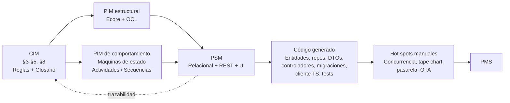
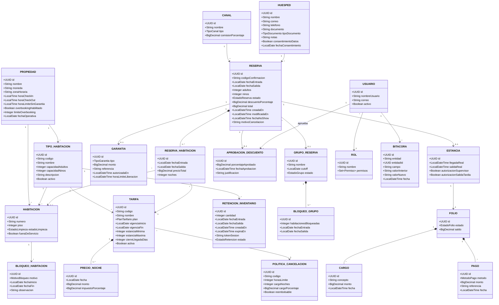
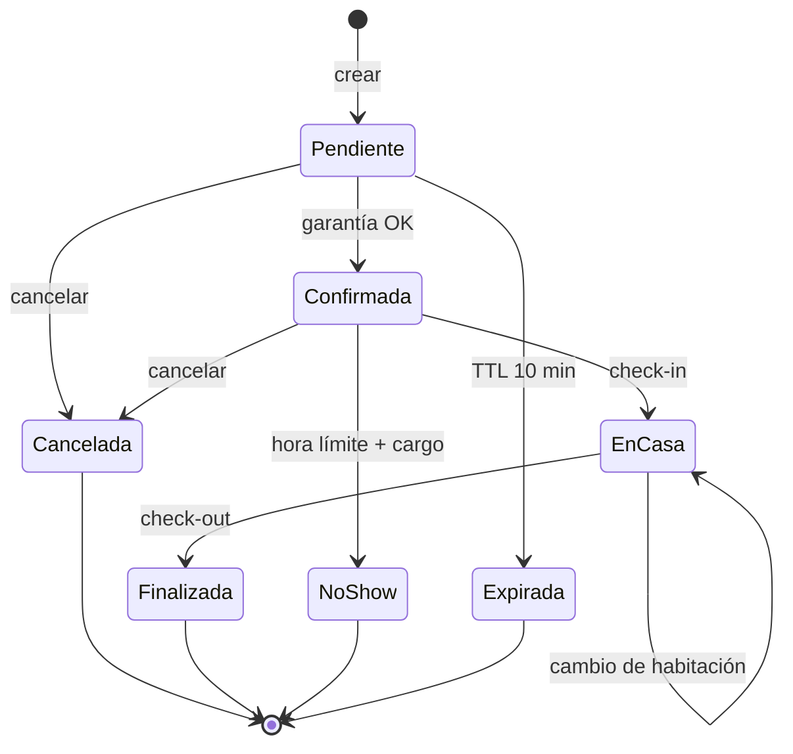
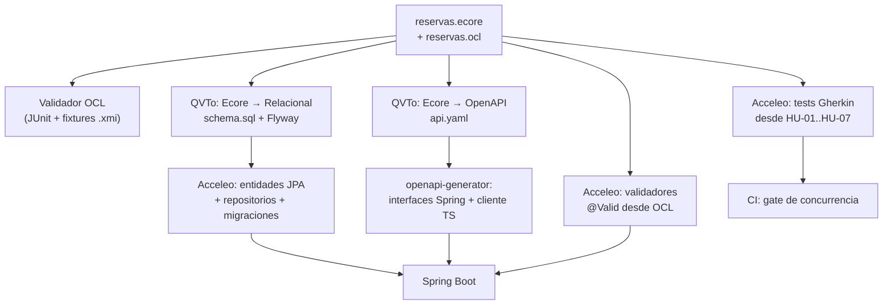

# Plan de construcción — PMS de reservas hoteleras

> **Documento para el agente BUILD.** Es autosuficiente: contiene el diagnóstico, las
> decisiones cerradas, el modelo de clases corregido, el catálogo de invariantes OCL,
> el pipeline MDD y el plan de sprints. No requiere leer la conversación original.
>
> **Documento fuente de requisitos:** `analisis_sistema_reservas_hotel.md`
> (raíz del proyecto, 1.009 líneas, 13 secciones).
>
> **Fecha:** 2026-11-12 · **Versión:** 1.0 · **Estado:** aprobado para implementación

---

## 0. Decisiones cerradas (no reabrir sin justificación)

| ID | Decisión | Valor |
|---|---|---|
| DEC-01 | Enfoque de ingeniería | **MDD completo**: Ecore + OCL + transformaciones M2M + M2T |
| DEC-02 | Stack backend | **Java 21 + Spring Boot 3.x + PostgreSQL 16** |
| DEC-03 | Alcance de la primera entrega | **Sprints 0–2: núcleo de reservas** (no check-in/out, no folio, no OTAs) |
| DEC-04 | Gestión de inventario | Restricción de exclusión en PostgreSQL (`btree_gist`) + retención con TTL |
| DEC-05 | Channel manager | **Integrar uno existente**, no construir (aplica a fases posteriores) |
| DEC-06 | Pasarela de pago | Pendiente de definir (fuera del alcance Sprints 0–2) |
| DEC-07 | Multi-propiedad | Modelo preparado desde el día 1 (`PROPIEDAD`); implementación mono-propiedad |

### Criterio de éxito de la entrega 1 (hito M1)

> **"El sistema nunca vende dos veces la misma habitación."**
> Demostrable con un test de concurrencia: 100 hilos intentando reservar la última
> habitación disponible → exactamente **1** reserva confirmada, **99** rechazos con
> alternativas. Este test es un *gate* de release, no un extra.

---

## 1. Diagnóstico del documento fuente

| Bloque | Aporta | Estado |
|---|---|---|
| §3 Necesidades N1–N10 + MoSCoW | Alcance y prioridad | Listo |
| §4 Actores (12) | Frontera del sistema | Listo (mezcla actores y sistemas) |
| §5 Reglas RN-01…RN-15 | **Activo más valioso** | Listo → convertidas a OCL en §4 |
| §6 Casos de uso (20) | Funcionalidad | 6 detallados; faltan CU-03/04/10/12/18 |
| §7 Historias (30, ≈163 pts) | Backlog | Listo para sprint planning |
| §8 Árboles de problemas | Justificación de negocio | Listo |
| §10 Modelo de datos | 13 entidades | **Corregido en §3 de este plan** |
| §11–12 | Fases, riesgos, preguntas | Insumo de gestión |

### Huecos del documento que este plan resuelve

1. El modelo de datos no soporta las reglas: faltan `ESTANCIA`, `RETENCION_INVENTARIO`,
   `PRECIO_NOCHE`, `BLOQUEO_HABITACION`, `GRUPO_RESERVA`, `GARANTIA`,
   `APROBACION_DESCUENTO`, `BITACORA`.
2. RN-01 no es expresable con un diagrama ER → requiere exclusión a nivel de BD.
3. No hay modelo de comportamiento formal (solo una línea de estados).
4. No hay contrato de integración (OTAs, pasarela, correo).
5. 12 de 30 historias no tienen criterios de aceptación.

---

## 2. Pipeline MDD



### Dos niveles de modelo

- **M1 — modelo del dominio hotelero:** las clases `RESERVA`, `HABITACION`, etc.
- **M2 — metamodelo:** el lenguaje con el que se describen esos modelos (Ecore).

### Reparto de esfuerzo

- **≈70 % generado:** entidades, repositorios, DTOs, controladores, migraciones,
  validadores Bean Validation derivados de OCL, cliente TypeScript, esqueletos de test,
  documentación y matriz de trazabilidad.
- **≈30 % manual (hot spots):**
  1. `DisponibilidadService` — consulta de RN-01 con lock y cache.
  2. `RetencionService` — TTL de 10 min + job de liberación.
  3. `TapeChartComponent` — calendario arrastrable.
  4. `BitacoraAspect` — auditoría transversal.
  5. Migración con la restricción `EXCLUDE`.
  6. Test de concurrencia (gate de release).

---

## 3. Modelo de clases corregido (PIM, nivel M1)

### 3.1 Cambios respecto al §10 del documento fuente

| Problema del §10 | Corrección | Regla |
|---|---|---|
| `RESERVA` hace de reserva y de estancia | Separar `RESERVA` (intención) de `ESTANCIA` (hecho) | RN-07, CU-05/06 |
| `RESERVA_HABITACION` sin fechas ni tarifa | La línea lleva fechas, tarifa, precio y habitación asignable | RN-01, RN-04, RN-10 |
| `TARIFA.precio_base` único | `PRECIO_NOCHE` por fecha | RN-04, HU-18 |
| No existe retención de inventario | `RETENCION_INVENTARIO` con TTL | CU-02, HU-06 |
| `HABITACION.fuera_de_servicio` booleano | `BLOQUEO_HABITACION` con rango de fechas | RN-13, CU-09 |
| `politica_cancelacion` como string | `POLITICA_CANCELACION` como entidad | RN-05, HU-05 |
| No existe garantía | `GARANTIA` con tipo y hora límite | RN-06, RN-08 |
| No existe aprobación de descuento | `APROBACION_DESCUENTO` | RN-09, HU-28 |
| `FOLIO` cuelga de `RESERVA` | `FOLIO` cuelga de `ESTANCIA` | CU-06 |
| `CANAL` solo origina reservas | `CANAL` con comisión → ADR/RevPAR | HU-30 |
| Sin grupos | `GRUPO_RESERVA` + `BLOQUEO_GRUPO` con cut-off | RN-10, HU-21 |

### 3.2 Diagrama de clases



> `BITACORA` se relaciona por `(entidad, entidadId)` en lugar de una FK por tabla.
> Es deliberado: audita todo sin 15 flechas y permite hacer la tabla append-only.

### 3.3 Enumeraciones (EEnum)

```text
EstadoReserva        = PENDIENTE | CONFIRMADA | EN_CASA | FINALIZADA | CANCELADA | NO_SHOW | EXPIRADA
EstadoLimpieza       = OCUPADA | SUCIA | EN_LIMPIEZA | LIMPIA | INSPECCIONADA | FUERA_DE_SERVICIO
PlanTarifario        = SOLO_HABITACION | DESAYUNO | MEDIA_PENSION
TipoCanal            = DIRECTO | TELEFONO | WALK_IN | WEB | OTA | AGENCIA | CORPORATIVO
TipoGarantia         = TARJETA | DEPOSITO | EMPRESA | SIN_GARANTIA
EstadoRetencion      = ACTIVA | CONSUMIDA | EXPIRADA | LIBERADA
MotivoBloqueo        = MANTENIMIENTO | USO_INTERNO | FUERA_DE_SERVICIO | CUARENTENA
EstadoFolio          = ABIERTO | CERRADO | SALDO_PENDIENTE
MetodoPago           = EFECTIVO | TARJETA | TRANSFERENCIA | DEPOSITO
TipoDocumento        = DNI | PASAPORTE | NIT | OTRO
EstadoGrupo          = TENTATIVO | CONFIRMADO | VENCIDO
Permiso              = RESERVA_CREAR | RESERVA_MODIFICAR | RESERVA_CANCELAR
                     | DESCUENTO_APLICAR | DESCUENTO_APROBAR
                     | CHECKIN_REALIZAR | CHECKOUT_REALIZAR | FOLIO_MODIFICAR
                     | HABITACION_ESTADO_CAMBIAR | TARIFA_MODIFICAR
                     | CIERRE_EJECUTAR | EXCEPCION_CIERRE
                     | USUARIO_ADMINISTRAR | REPORTE_VER | OVERBOOKING_HABILITAR
```

### 3.4 Alcance por iteración

| Entidad | S0 | S1 | S2 | Después |
|---|---|---|---|---|
| PROPIEDAD, TIPO_HABITACION, HABITACION | modelar | **implementar** | — | — |
| TARIFA, PRECIO_NOCHE, POLITICA_CANCELACION | modelar | **implementar** | — | — |
| CANAL, HUESPED | modelar | **implementar** | — | — |
| RESERVA, RESERVA_HABITACION, GARANTIA | modelar | — | **implementar** | — |
| RETENCION_INVENTARIO | modelar | — | **implementar** | — |
| APROBACION_DESCUENTO | modelar | — | **implementar** | — |
| USUARIO, ROL, BITACORA | modelar | — | **implementar** | — |
| BLOQUEO_HABITACION | modelar | — | modelar | S3 |
| ESTANCIA, FOLIO, CARGO, PAGO | modelar | — | — | S3 |
| GRUPO_RESERVA, BLOQUEO_GRUPO | modelar | — | — | S7 |

**Regla del proyecto:** todo se modela ahora (para que metamodelo y OCL sean correctos),
pero solo se implementa lo marcado en la columna del sprint. El generador emite código
solo para los paquetes habilitados en cada iteración.

### 3.5 Decisiones de modelado (justificación para el informe)

| # | Decisión | Alternativa descartada | Por qué |
|---|---|---|---|
| D1 | `RESERVA` ≠ `ESTANCIA` | Una entidad con estado | RN-07 valida la habitación *al hacer check-in*; el folio pertenece a la estancia |
| D2 | `RESERVA_HABITACION` con fechas propias | Fechas solo en `RESERVA` | Grupos (RN-10) y reservas multi-habitación necesitan fechas por línea |
| D3 | `PRECIO_NOCHE` por fecha | `precio_base` + multiplicadores | RN-04 exige variación por temporada, día, canal y plan |
| D4 | `RETENCION_INVENTARIO` persistida | Lock en memoria | CU-02 exige TTL sobrevivible a reinicios y visible en el tape chart |
| D5 | `POLITICA_CANCELACION` entidad | Enum/string | RN-05 dice "configurables" |
| D6 | `BLOQUEO_HABITACION` con rango | Booleano | RN-13 necesita bloquear fechas sin sacar la habitación del año entero |
| D7 | `GARANTIA.horaLimiteLiberacion` | `garantizada: boolean` | RN-06/08 necesitan saber *cuándo* liberar y *cuánto* cobrar |
| D8 | `APROBACION_DESCUENTO` separada | Campo `aprobado_por` | RN-09/HU-28 requieren flujo con justificación y auditoría |
| D9 | `BITACORA` genérica | FK por tabla | RN-12 cubre reserva, tarifa y pago |
| D10 | Enums como EEnum | Strings libres | OCL puede validar `Set{...}` y el generador emite `enum` Java |

### 3.6 Máquinas de estado (PIM de comportamiento)



**Habitación:** `OCUPADA → SUCIA → EN_LIMPIEZA → LIMPIA → INSPECCIONADA`, alterno `FUERA_DE_SERVICIO`.
**Folio:** `ABIERTO → CERRADO` (posible `SALDO_PENDIENTE`).
**Retención:** `ACTIVA → CONSUMIDA | EXPIRADA | LIBERADA`.

Cada transición se anota con la regla que la habilita → trazabilidad RN ↔ estado ↔ test.

---

## 4. Catálogo de invariantes OCL

Convenciones: `EDate`/`EDateTime` son tipos de Eclipse OCL mapeados a
`java.time.LocalDate`/`LocalDateTime`; `Decimal` → `BigDecimal`.

### 4.1 Reglas del documento fuente

#### RN-01 — Sin solapamiento de reservas en la misma habitación

```ocl
context RESERVA_HABITACION
def: estaActiva() : Boolean =
  self.reserva.estado = EstadoReserva::PENDIENTE or
  self.reserva.estado = EstadoReserva::CONFIRMADA or
  self.reserva.estado = EstadoReserva::EN_CASA

context RESERVA_HABITACION inv sinSolapamientoEnHabitacion:
  self.habitacion->notEmpty() implies
    RESERVA_HABITACION.allInstances()->forAll(otra |
      otra <> self and
      otra.habitacion = self.habitacion and
      otra.estaActiva() and self.estaActiva()
      implies
      (self.fechaSalida <= otra.fechaEntrada or otra.fechaSalida <= self.fechaEntrada))
```

> `<=` / `<=` porque la noche de salida no se solapa con la de entrada. Equivale a
> `daterange(..., '[)')` en PostgreSQL.

#### RN-01b — Bloqueo no solapa reservas activas

```ocl
context BLOQUEO_HABITACION inv bloqueoNoSolapaReserva:
  RESERVA_HABITACION.allInstances()->forAll(rh |
    rh.habitacion = self.habitacion and rh.estaActiva() implies
    (rh.fechaSalida <= self.fechaInicio or self.fechaFin <= rh.fechaEntrada))
```

#### RN-02 — Horas estándar y cargos por extensión

```ocl
context PROPIEDAD inv horasEstandar:
  self.horaCheckIn.hour = 15 and self.horaCheckOut.hour = 12

context ESTANCIA inv lateCheckOutRequiereAutorizacion:
  self.salidaReal.toLocalTime() > self.propiedad.horaCheckOut implies
    self.autorizacionSalidaTardia = true

context ESTANCIA inv earlyCheckInRequiereAutorizacion:
  self.llegadaReal.toLocalTime() < self.propiedad.horaCheckIn implies
    self.autorizacionSupervisor = true
```

#### RN-03 — Datos mínimos de una reserva

```ocl
context RESERVA inv datosMinimos:
  not self.titular.oclIsUndefined() and
  self.titular.nombre.trim().size() > 0 and
  (self.titular.correo.trim().size() > 0 or self.titular.telefono.trim().size() > 0) and
  self.fechaEntrada < self.fechaSalida and
  self.adultos >= 1 and
  self.ninos >= 0 and
  self.lineas->notEmpty() and
  self.lineas->forAll(l | not l.tarifa.oclIsUndefined())
```

#### RN-04 — Precio completo y mínimos de estancia

```ocl
context RESERVA_HABITACION
def: noches() : Integer =
  self.fechaSalida.daysBetween(self.fechaEntrada)

context RESERVA_HABITACION inv todasLasNochesTienenPrecio:
  self.tarifa.precios->select(p |
    p.fecha >= self.fechaEntrada and p.fecha < self.fechaSalida
  )->size() = self.noches()

context RESERVA_HABITACION inv tarifaVigente:
  self.fechaEntrada >= self.tarifa.vigenciaInicio and
  self.fechaSalida <= self.tarifa.vigenciaFin.plusDays(1)

context RESERVA_HABITACION inv estanciaMinimaCumplida:
  self.noches() >= self.tarifa.estanciaMinima

context RESERVA_HABITACION inv estanciaMaximaCumplida:
  self.tarifa.estanciaMaxima = 0 or self.noches() <= self.tarifa.estanciaMaxima

context RESERVA_HABITACION inv cierreDeLlegada:
  self.fechaEntrada <= self.tarifa.vigenciaFin.minusDays(self.tarifa.cierreLlegadaDias)
```

#### RN-05 — Políticas de cancelación configurables

```ocl
context POLITICA_CANCELACION inv flexible:
  self.codigo = 'FLEXIBLE' implies
    self.horasLimite = 48 and self.cargoNoches = 0 and self.reembolsable = true

context POLITICA_CANCELACION inv moderada:
  self.codigo = 'MODERADA' implies
    self.cargoNoches = 1 and self.reembolsable = true

context POLITICA_CANCELACION inv noReembolsable:
  self.codigo = 'NO_REEMBOLSABLE' implies
    self.cargoPorcentaje = 100 and self.reembolsable = false

context RESERVA inv cargoCancelacionConforme:
  self.estado = EstadoReserva::CANCELADA implies
    self.cargoCancelacion = self.politicaCancelacion.cargoPara(
      self.fechaCancelacion, self.fechaEntrada, self.total)
```

```ocl
context POLITICA_CANCELACION::cargoPara(
    fechaCancelacion : EDateTime,
    fechaEntrada : EDate,
    total : Decimal) : Decimal
post resultadoConforme:
  let horasAntes : Integer = fechaCancelacion.hoursUntil(fechaEntrada) in
  if self.codigo = 'NO_REEMBOLSABLE' then
    result = total * self.cargoPorcentaje / 100
  else if horasAntes >= self.horasLimite then
    result = 0
  else
    result = self.cargoNoches * reserva.precioNoche(fechaEntrada)
  endif endif
```

> `RESERVA::precioNoche(f: EDate): Decimal` es una operación derivada que evita
> duplicar la lógica de precios dentro de la política.

#### RN-06 — Liberación automática de reservas sin garantía

```ocl
context RESERVA inv sinGarantiaTieneHoraLimite:
  self.garantia->notEmpty() and self.garantia.tipo = TipoGarantia::SIN_GARANTIA
  implies
  self.garantia.horaLimiteLiberacion =
    self.fechaEntrada.atTime(self.propiedad.horaLimiteSinGarantia)

context RESERVA inv expiradaSoloSinGarantia:
  self.estado = EstadoReserva::EXPIRADA implies
    self.garantia->notEmpty() and self.garantia.tipo = TipoGarantia::SIN_GARANTIA

context RESERVA inv confirmadaRequiereGarantia:
  self.estado = EstadoReserva::CONFIRMADA implies
    self.garantia->notEmpty()
```

#### RN-07 — Solo se entrega habitación limpia o inspeccionada

```ocl
context ESTANCIA inv habitacionLista:
  self.habitacion.estadoLimpieza = EstadoLimpieza::LIMPIA or
  self.habitacion.estadoLimpieza = EstadoLimpieza::INSPECCIONADA or
  self.autorizacionSupervisor = true

context ESTANCIA inv habitacionNoBloqueada:
  self.habitacion.bloqueos->forAll(b |
    self.llegadaReal.toLocalDate() < b.fechaInicio or
    self.llegadaReal.toLocalDate() >= b.fechaFin)
```

#### RN-08 — No-show con cargo

```ocl
context RESERVA inv noShowTrasHoraLimite:
  self.estado = EstadoReserva::NO_SHOW implies
    self.fechaNoShow.toLocalDate() = self.fechaEntrada and
    self.fechaNoShow.toLocalTime() >= self.horaLimiteLlegada

context RESERVA inv noShowConCargo:
  self.estado = EstadoReserva::NO_SHOW implies
    self.cargoNoShow = self.politicaCancelacion.cargoNoShow(self.total)
```

#### RN-09 — Descuentos mayores al 10 % requieren gerencia

```ocl
context RESERVA inv descuentoAprobado:
  self.descuentoPorcentaje > 10 implies
    self.aprobacionDescuento->notEmpty() and
    self.aprobacionDescuento.porcentajeAprobado >= self.descuentoPorcentaje and
    self.aprobacionDescuento.aprobadoPor.tienePermiso(Permiso::DESCUENTO_APROBAR)

context RESERVA inv descuentoEnRango:
  self.descuentoPorcentaje >= 0 and self.descuentoPorcentaje <= 100
```

#### RN-10 — Grupos de 5+ habitaciones con cut-off

```ocl
context BLOQUEO_GRUPO inv minimoHabitaciones:
  self.habitacionesBloqueadas >= 5

context GRUPO_RESERVA inv cutoffValido:
  self.cutoff > self.creadoEn.toLocalDate() and
  self.cutoff <= self.bloqueos->collect(b | b.fechaEntrada)->min()

context GRUPO_RESERVA inv vencidoLiberaInventario:
  self.estado = EstadoGrupo::VENCIDO implies
    self.cutoff < self.fechaOperativa
```

#### RN-11 — Bloqueo tras el cierre del día

```ocl
context PROPIEDAD inv cierreNoRetrocede:
  self.ultimoCierre->notEmpty() implies
    self.fechaOperativa >= self.ultimoCierre.fechaOperativa

context RESERVA inv noModificableTrasCierre:
  self.modificadaEn.toLocalDate() <= self.propiedad.fechaOperativa implies
    self.modificadaPor->notEmpty() and
    (self.modificadaPor.tienePermiso(Permiso::EXCEPCION_CIERRE) or
     self.modificadaEn.toLocalDate() > self.propiedad.ultimoCierre.fechaOperativa)
```

#### RN-12 — Todo cambio queda en bitácora

```ocl
context BITACORA inv entradaCompleta:
  self.entidad.trim().size() > 0 and
  not self.entidadId.oclIsUndefined() and
  not self.usuario.oclIsUndefined() and
  not self.fecha.oclIsUndefined() and
  self.valorAnterior <> self.valorNuevo

context RESERVA inv modificacionesAuditadas:
  self.modificadaEn > self.creadaEn implies
    self.bitacora->exists(b | b.fecha = self.modificadaEn)
```

> **Inmutabilidad:** `BITACORA` se genera con `@Immutable` y sin `UPDATE` en el
> repositorio. Un invariante OCL no puede impedir un `UPDATE` en SQL: es una decisión
> arquitectónica.

#### RN-13 — Fuera de servicio no es vendible

```ocl
context HABITACION
def: bloqueadaEn(fecha : EDate) : Boolean =
  self.fueraDeServicio or
  self.bloqueos->exists(b | fecha >= b.fechaInicio and fecha < b.fechaFin)

context HABITACION inv fueraDeServicioSinReservasActivas:
  self.fueraDeServicio implies
    RESERVA_HABITACION.allInstances()->forAll(rh |
      rh.habitacion = self and rh.estaActiva() implies
      rh.reserva.estado = EstadoReserva::CANCELADA)
```

#### RN-14 — Overbooking desactivado por defecto

```ocl
context PROPIEDAD inv overbookingControlado:
  self.overbookingHabilitado implies
    self.limiteOverbooking > 0 and
    self.overbookingHabilitadoPor->notEmpty() and
    self.overbookingHabilitadoPor.tienePermiso(Permiso::OVERBOOKING_HABILITAR)

context PROPIEDAD inv overbookingDesactivadoPorDefecto:
  self.overbookingHabilitadoPor->isEmpty() implies
    self.overbookingHabilitado = false and self.limiteOverbooking = 0
```

#### RN-15 — Protección de datos

```ocl
context HUESPED inv consentimientoAntesDeTratar:
  self.datosPersonales->notEmpty() implies
    self.consentimientoDatos = true and self.fechaConsentimiento->notEmpty()

context HUESPED inv derechoDeSupresion:
  self.solicitudSupresion->notEmpty() implies
    self.datosAnonimizados = true and self.notas->isEmpty()

context HUESPED inv correoValido:
  self.correo.matches('[A-Za-z0-9._%+-]+@[A-Za-z0-9.-]+\\.[A-Za-z]{2,}')
```

### 4.2 Invariantes adicionales exigidos por el núcleo

```ocl
-- Integridad de fechas
context RESERVA inv fechasCoherentes:
  self.fechaEntrada < self.fechaSalida and
  self.noches() = self.fechaSalida.daysBetween(self.fechaEntrada)

context RESERVA
def: noches() : Integer = self.fechaSalida.daysBetween(self.fechaEntrada)

-- Código de confirmación único
context RESERVA inv codigoConfirmacionUnico:
  RESERVA.allInstances()->forAll(r |
    r <> self implies r.codigoConfirmacion <> self.codigoConfirmacion)

-- Las líneas no salen del rango de la reserva
context RESERVA_HABITACION inv fechasDentroDeReserva:
  self.fechaEntrada >= self.reserva.fechaEntrada and
  self.fechaSalida <= self.reserva.fechaSalida

-- La habitación asignada es del tipo contratado
context RESERVA_HABITACION inv tipoHabitacionCoherente:
  self.habitacion->notEmpty() implies
    self.habitacion.tipo = self.tipoHabitacion

-- Retención con TTL exacto de 10 minutos (CU-02)
context RETENCION_INVENTARIO inv ttlDiezMinutos:
  self.expiraEn.minutesBetween(self.creadaEn) = 10

context RETENCION_INVENTARIO inv expiradaNoConsumible:
  self.estado = EstadoRetencion::EXPIRADA implies self.consumidaEn->isEmpty()

-- Total de la reserva = suma de líneas menos descuento
context RESERVA inv totalConsistente:
  self.total =
    (self.lineas->collect(l | l.precioTotal)->sum() -
     self.lineas->collect(l | l.precioTotal)->sum() * self.descuentoPorcentaje / 100)
    ->round(2)

-- Capacidad del tipo respetada por línea
context RESERVA_HABITACION inv capacidadRespetada:
  self.reserva.adultos <= self.tipoHabitacion.capacidadAdultos * self.reserva.lineas->size() and
  self.reserva.ninos  <= self.tipoHabitacion.capacidadNinos  * self.reserva.lineas->size()
```

### 4.3 Contratos de operación (pre/post)

```ocl
context RESERVA::crear(
    titular : HUESPED,
    entrada : EDate,
    salida  : EDate,
    adultos : Integer,
    ninos   : Integer,
    tarifa  : TARIFA,
    canal   : CANAL) : RESERVA
pre fechasFuturas:
  entrada >= propiedadDelSistema.fechaOperativa and salida > entrada
pre hayInventario:
  TIPO_HABITACION.allInstances()->exists(t |
    t = tarifa.tipoHabitacion and t.disponiblesEn(entrada, salida) > 0)
post estadoInicial:
  result.estado = EstadoReserva::PENDIENTE
post retencionCreada:
  result.retencion->notEmpty() and result.retencion.estado = EstadoRetencion::ACTIVA
post auditada:
  result.bitacora->exists(b | b.accion = 'CREAR')
post codigoGenerado:
  result.codigoConfirmacion.size() = 8

context RESERVA::confirmar(garantia : GARANTIA)
pre desdePendiente:
  self.estado = EstadoReserva::PENDIENTE
pre retencionVigente:
  self.retencion.estado = EstadoRetencion::ACTIVA and
  self.retencion.expiraEn > ahora
post confirmada:
  self.estado = EstadoReserva::CONFIRMADA
post retencionConsumida:
  self.retencion.estado = EstadoRetencion::CONSUMIDA
post garantiaAsociada:
  self.garantia = garantia and garantia.autorizadaEn->notEmpty()

context RESERVA::cancelar(fechaCancelacion : EDateTime, motivo : String)
pre cancelable:
  self.estado = EstadoReserva::PENDIENTE or self.estado = EstadoReserva::CONFIRMADA
post estadoCancelada:
  self.estado = EstadoReserva::CANCELADA
post inventarioLiberado:
  self.lineas->forAll(l | l.habitacion->isEmpty() or
    l.habitacion.estadoLimpieza <> EstadoLimpieza::OCUPADA)
post cargoCalculado:
  self.cargoCancelacion = self.politicaCancelacion.cargoPara(
    fechaCancelacion, self.fechaEntrada, self.total)
post motivoRegistrado:
  self.motivoCancelacion = motivo and self.fechaCancelacion = fechaCancelacion
post auditada:
  self.bitacora->exists(b | b.accion = 'CANCELAR' and b.fecha = fechaCancelacion)

context RESERVA::modificar(entrada : EDate, salida : EDate)
pre modificable:
  self.estado = EstadoReserva::PENDIENTE or self.estado = EstadoReserva::CONFIRMADA
pre fechasValidas:
  entrada < salida and entrada >= self.propiedad.fechaOperativa
pre hayInventarioNuevo:
  self.lineas->forAll(l | l.tipoHabitacion.disponiblesEn(entrada, salida) >= 1)
post fechasActualizadas:
  self.fechaEntrada = entrada and self.fechaSalida = salida
post totalRecalculado:
  self.total = self.calcularTotal()
post auditada:
  self.bitacora->exists(b | b.accion = 'MODIFICAR' and b.fecha = self.modificadaEn)

context RESERVA::marcarNoShow()
pre confirmadaSinLlegar:
  self.estado = EstadoReserva::CONFIRMADA and
  ahora > self.fechaEntrada.atTime(self.horaLimiteLlegada)
post estadoNoShow:
  self.estado = EstadoReserva::NO_SHOW and self.fechaNoShow = ahora
```

### 4.4 Matriz de trazabilidad y mecanismo de enforcement

| Regla | Invariante OCL | Modelo | BD | Servicio | Test |
|---|---|:---:|:---:|:---:|:---:|
| RN-01 | `sinSolapamientoEnHabitacion` | ✔ | **EXCLUDE gist** | ✔ | **concurrencia 100 hilos** |
| RN-01b | `bloqueoNoSolapaReserva` | ✔ | — | ✔ | ✔ |
| RN-02 | `horasEstandar`, `*RequiereAutorizacion` | ✔ | — | ✔ | ✔ |
| RN-03 | `datosMinimos` | ✔ | NOT NULL | ✔ | ✔ |
| RN-04 | `todasLasNochesTienenPrecio` | ✔ | — | ✔ | ✔ |
| RN-05 | `cargoCancelacionConforme` | ✔ | — | ✔ | ✔ |
| RN-06 | `sinGarantiaTieneHoraLimite` | ✔ | — | job scheduler | ✔ |
| RN-07 | `habitacionLista` | ✔ | — | ✔ | ✔ |
| RN-08 | `noShowTrasHoraLimite` | ✔ | — | job nocturno | ✔ |
| RN-09 | `descuentoAprobado` | ✔ | — | ✔ | ✔ |
| RN-10 | `minimoHabitaciones` | ✔ | CHECK | ✔ | ✔ |
| RN-11 | `noModificableTrasCierre` | ✔ | — | ✔ | ✔ |
| RN-12 | `modificacionesAuditadas` | parcial | trigger append-only | ✔ | ✔ |
| RN-13 | `fueraDeServicioSinReservasActivas` | ✔ | — | ✔ | ✔ |
| RN-14 | `overbookingControlado` | ✔ | CHECK | ✔ | ✔ |
| RN-15 | `consentimientoAntesDeTratar` | ✔ | — | ✔ | ✔ |
| — | `codigoConfirmacionUnico` | ✔ | **UNIQUE** | — | ✔ |
| — | `ttlDiezMinutos` | ✔ | — | ✔ | ✔ |
| — | `totalConsistente` | ✔ | — | ✔ | ✔ |

> **El invariante OCL nunca es el mecanismo de concurrencia.** OCL valida *modelos*;
> la carrera por la última habitación la resuelve PostgreSQL.

### 4.5 SQL obligatorio (no generado por OCL)

```sql
CREATE EXTENSION IF NOT EXISTS btree_gist;

ALTER TABLE reserva_habitacion
  ADD CONSTRAINT rh_sin_solape
  EXCLUDE USING gist (
    habitacion_id WITH =,
    daterange(fecha_entrada, fecha_salida, '[)') WITH &&
  )
  WHERE (estado_activo);
```

Consulta de disponibilidad (RN-01 a nivel de tipo):

```sql
SELECT th.id, count(*) AS libres
FROM tipo_habitacion th
JOIN habitacion h ON h.tipo_habitacion_id = th.id AND NOT h.fuera_de_servicio
WHERE NOT EXISTS (
  SELECT 1 FROM reserva_habitacion rh
  JOIN reserva r ON r.id = rh.reserva_id
  WHERE rh.habitacion_id = h.id
    AND r.estado IN ('PENDIENTE','CONFIRMADA','EN_CASA')
    AND daterange(rh.fecha_entrada, rh.fecha_salida, '[)')
        && daterange(:entrada, :salida, '[)')
)
GROUP BY th.id
HAVING count(*) >= :habitacionesRequeridas;
```

---

## 5. Materialización en Ecore

### 5.1 Anotación de invariantes

```xml
<eClassifiers xsi:type="ecore:EClass" name="Reserva">
  <eAnnotations source="http://www.eclipse.org/emf/2002/Ecore">
    <details key="constraints"
      value="datosMinimos fechasCoherentes codigoConfirmacionUnico descuentoAprobado"/>
  </eAnnotations>
  <eAnnotations source="http://www.eclipse.org/emf/2002/Ecore/OCL">
    <details key="datosMinimos"
      value="not self.titular.oclIsUndefined() and self.adultos &gt;= 1 ..."/>
    <details key="fechasCoherentes"
      value="self.fechaEntrada &lt; self.fechaSalida"/>
    <details key="codigoConfirmacionUnico"
      value="RESERVA.allInstances()-&gt;forAll(r | r &lt;&gt; self implies r.codigoConfirmacion &lt;&gt; self.codigoConfirmacion)"/>
    <details key="descuentoAprobado"
      value="self.descuentoPorcentaje &gt; 10 implies self.aprobacionDescuento-&gt;notEmpty()"/>
  </eAnnotations>
  <eStructuralFeatures xsi:type="ecore:EReference" name="lineas" upperBound="-1"
      eType="#//ReservaHabitacion" containment="true" eOpposite="#//ReservaHabitacion/reserva"/>
</eClass>
```

### 5.2 Mapeo de tipos

| Modelo | Ecore | Java generado | PostgreSQL |
|---|---|---|---|
| `EDate` | `EcoreEDataType` | `LocalDate` | `date` |
| `EDateTime` | `EcoreEDataType` | `LocalDateTime` | `timestamptz` |
| `Decimal` | `EcoreEDataType` | `BigDecimal` | `numeric(12,2)` |
| `UUID` | `EcoreEDataType` | `UUID` | `uuid` |
| Enumeraciones | `EEnum` + `EEnumLiteral` | `enum` | `varchar` + CHECK |
| `RESERVA *-- RESERVA_HABITACION` | `containment=true` | `@OneToMany(cascade=ALL)` | FK `reserva_id` |

### 5.3 Pipeline concreto (Sprints 0–2)



### 5.4 Fixture de validación del OCL

Modelo `.xmi` de prueba con:

- 2 tipos de habitación, 4 habitaciones, 1 tarifa con 30 `PRECIO_NOCHE`.
- 3 reservas: una solapada a propósito, una con 20 % de descuento sin aprobación,
  una sin garantía.
- **Resultado esperado: exactamente 2 violaciones, ninguna más.**
  Este fixture es el contrato del modelo.

---

## 6. Plan de sprints

Backlog total del documento: **30 historias ≈ 163 puntos**. Velocidad asumida: 22 pts/sprint.

| Sprint | Contenido | HU / CU | Pts | Entregable demostrable |
|---|---|---|---|---|
| **S0** | Inception, tooling, `reservas.ecore` + `reservas.ocl`, validador con fixture, CI | — | — | Generador que produce un CRUD trivial + modelo validado |
| **S1** | Inventario, tipos, tarifas, disponibilidad | HU-01, HU-18, CU-01 | 21 | Consulta de disponibilidad correcta con precios |
| **S2** | Reservas crear/modificar/cancelar + concurrencia + calendario | HU-03,04,05,06,07 | 29 | **M1: cero sobreventa demostrada con test de carga** |
| S3 | Check-in/out, folio, pagos (mock), estados de habitación | HU-08,11,12,14,15 | 23 | Ciclo completo huésped → cama → cobro |
| S4 | Perfil, roles, bitácora, reportes base | HU-09,26,27,30 | 19 | Panel de ocupación/ADR/RevPAR |
| S5 | Motor web, notificaciones, pre-registro, no-show | HU-02,23,24,19 | 23 | Reserva directa con pago real en staging |
| S6 | Channel manager, cierre del día, cancelaciones automáticas | HU-20,29,05 | 26 | Sync <1 min + cierre <20 min |
| S7 | Grupos, mantenimiento, cuentas divididas, hardening, piloto | HU-21,17,13,16 | 22 | Release candidate + migración |

### Hitos de control

- **M1 (fin S2):** "el sistema nunca vende dos veces la misma habitación".
- **M2 (fin S4):** "la operación diaria vive en el sistema, no en Excel/WhatsApp".
- **M3 (fin S6):** "dejamos de entrar a las extranets".
- **M4 (fin S7):** criterios de éxito de §11 medibles.

### Desglose del Sprint 0 (primer trabajo de BUILD)

**Tareas:**

1. Crear repo Maven multi-módulo:
   - `pms-model` (Ecore, OCL, generación)
   - `pms-generator` (QVTo + Acceleo)
   - `pms-backend` (Spring Boot)
   - `pms-frontend` (Angular/React + cliente TS)
   - `pms-docs` (trazabilidad, diagramas)
2. Plugins: EMF, Eclipse OCL, QVTo, Acceleo, `openapi-generator-maven-plugin`, Flyway, Testcontainers.
3. Escribir `reservas.ecore` con las 24 clases, 12 enums y las referencias de §3.2.
4. Escribir `reservas.ocl` con las invariantes de §4.1 y §4.2.
5. Montar el validador: JUnit + `OCL.newInstance()` + carga del fixture `.xmi`;
   aserción de 2 violaciones exactas.
6. Definir el perfil de generación por sprint (qué paquetes se emiten).
7. CI: `mvn verify` + `docker compose up postgres` + Testcontainers.
8. Generar el `schema.sql` con QVTo y validar la restricción `EXCLUDE` contra PostgreSQL real.

**Criterios de done de S0:**

- [ ] `mvn verify` en verde.
- [ ] El fixture produce exactamente 2 violaciones OCL.
- [ ] El `schema.sql` generado se aplica sin errores en PostgreSQL 16.
- [ ] La restricción `rh_sin_solape` rechaza un insert solapado (test de integración).
- [ ] Existe un endpoint `/health` generado y funcionando.
- [ ] La matriz de trazabilidad se genera automáticamente.

---

## 7. Riesgos y mitigaciones

| Riesgo del doc | Cómo lo cubre este plan |
|---|---|
| R1 Resistencia al cambio | Capacitación por rol + piloto con un turno (S7) |
| R2 OTA compleja | DEC-05: integrar channel manager, no construir |
| R3 Carreras de inventario | `EXCLUDE gist` + test de concurrencia como gate |
| R4 Privacidad | RN-15 modelada en PIM desde el inicio |
| R5 Caída de internet | RNF-15 como requisito arquitectónico, no feature tardío |
| R6 Migración | S7 explícito; regla "solo reservas futuras" |
| R7 Alcance | MoSCoW congelado; "Could" no entra hasta M2 |

### Riesgos propios del enfoque MDD

| Riesgo | Mitigación |
|---|---|
| El metamodelo se vuelve más caro que el código | Perfil de generación por sprint; si un paquete no se genera, no se modela en detalle |
| OCL con `allInstances()` no escala en runtime | Solo validación de modelos; runtime usa SQL/servicio |
| Transformaciones frágiles | Fixtures `.xmi` versionados + tests de regresión de generación |
| Sobre-ingeniería en S0 | Timebox de 2 semanas; si el generador no produce nada útil, se simplifica a plantillas Jinja2 |

---

## 8. Preguntas abiertas (bloquean fases posteriores, no Sprints 0–2)

1. ¿Channel manager propio o existente? → DEC-05: existente; falta elegir proveedor.
2. ¿Pasarela de pago y métodos aceptados? → fuera de alcance Sprints 0–2.
3. ¿Facturación fiscal local y proveedor? → S3/S7.
4. ¿Más de una propiedad? → modelo preparado, implementación mono-propiedad.
5. ¿Cerraduras electrónicas? → Won't por ahora.
6. ¿Qué datos migrar y en qué formato? → S7.
7. ¿Product owner del hotel? → pendiente de confirmar.
8. ¿Idiomas y monedas desde el día 1? → español + moneda configurable.
9. ¿Presupuesto y calendario reales? → pendiente.
10. ¿Overbooking controlado? → RN-14: desactivado por defecto, habilitable por gerencia.

---

## 9. Trazabilidad de artefactos

| Requisito fuente | Artefacto de modelo | Artefacto de código | Artefacto de prueba |
|---|---|---|---|
| §4 Actores | Actores de casos de uso | Roles y permisos (`Permiso`) | Tests de autorización |
| §5 RN-01…RN-15 | `reservas.ocl` §4 | Validadores + SQL | Fixture `.xmi` + integración |
| §6 Casos de uso | Diagramas de actividad/secuencia | Controladores REST | Tests de API |
| §7 Historias + Gherkin | — | — | Cucumber |
| §10 Modelo de datos | `reservas.ecore` §3 | Entidades JPA | Tests de repositorio |
| §9 RNF | Restricciones de arquitectura | Configuración | Tests de carga |

---

*Fin del plan. Versión 1.0 — lista para ejecución por el agente BUILD.*
